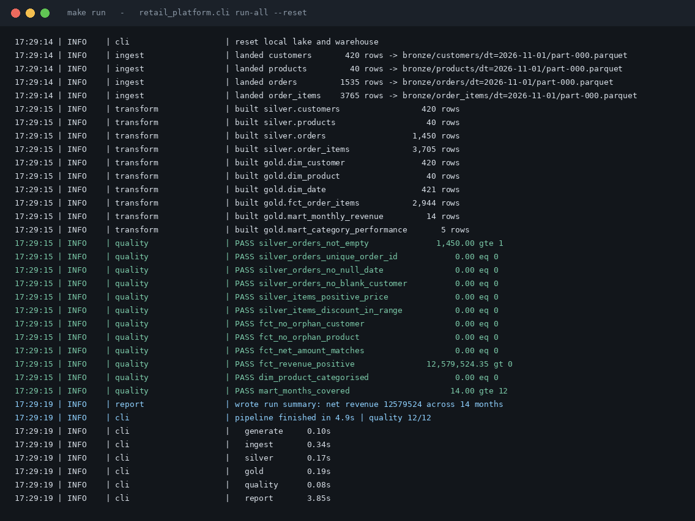
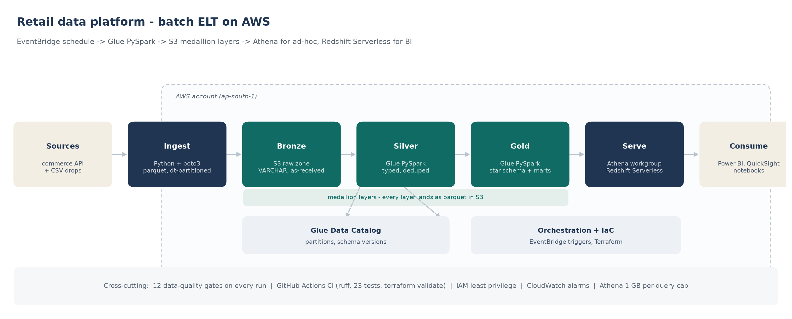
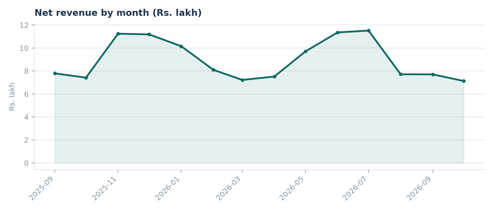
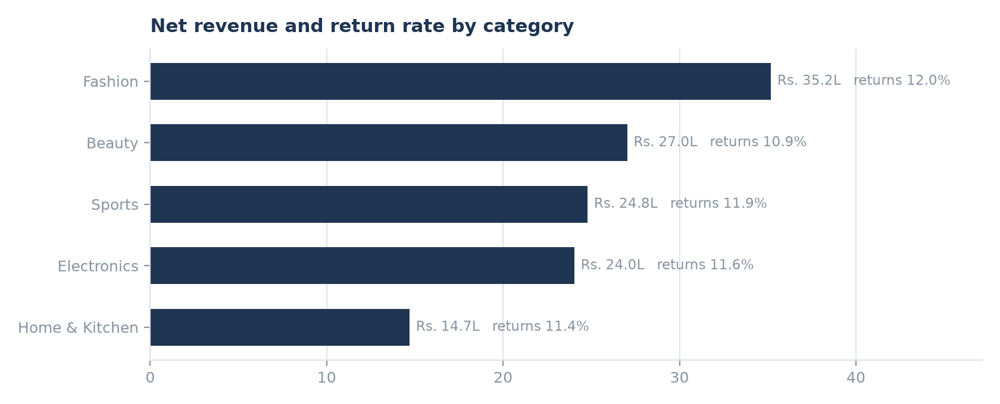
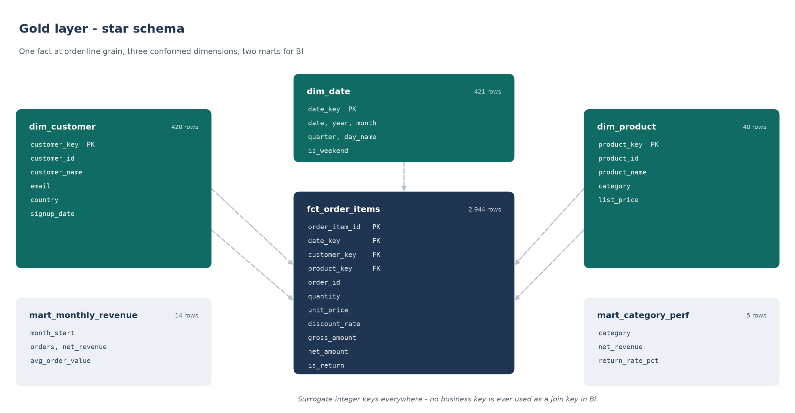
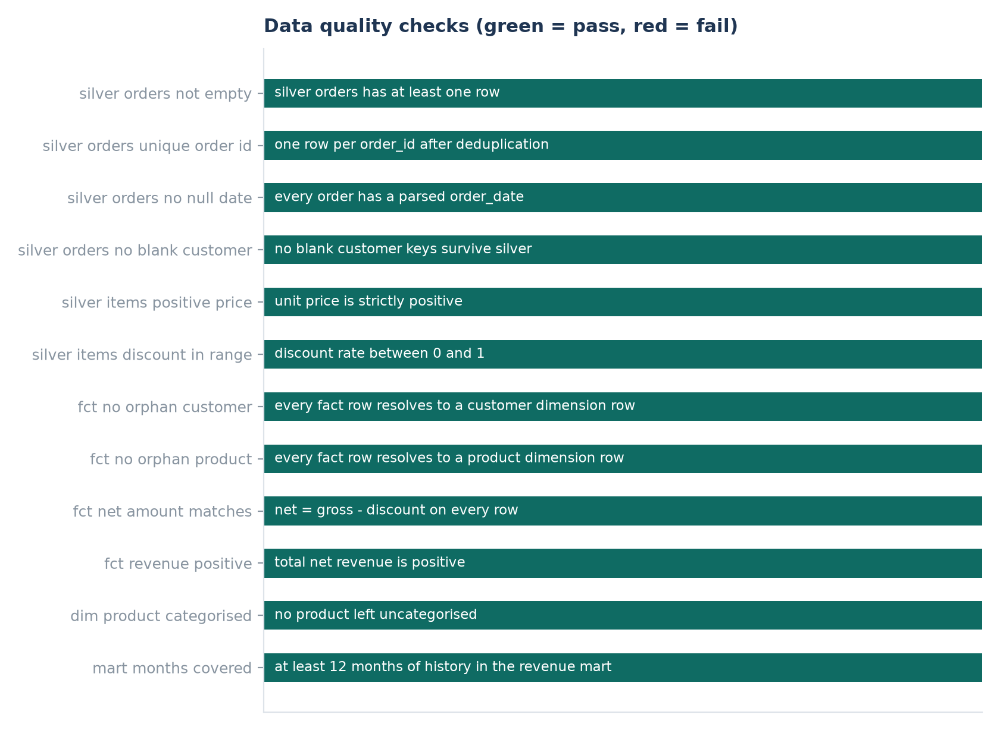

# Retail Data Platform - batch ELT on AWS


An end-to-end batch ELT platform that turns messy e-commerce exports into a
tested star schema in S3, queryable from Athena for ad-hoc analysis and
Redshift Serverless for BI. The whole pipeline runs **locally in about 5 seconds
with no AWS account**; the same code deploys to AWS with one `terraform apply`.

| Signal | Value |
|---|---|
| Data quality gates | 12 / 12 passing on every run |
| Tests | 23 passing (`pytest`), 0 skipped |
| Pipeline runtime | under 1 s for 5,760 raw rows; ~5 s including chart rendering |
| Infrastructure | 100% Terraform, no console clicking |
| Cost of the local demo | Rs. 0 |



---

## The problem this solves

A commerce team exports orders, order lines, customers and products as CSV from
four different places. Every export arrives slightly differently: two date
formats in one column, eleven spellings of five order statuses, currency symbols
inside numeric fields, duplicate rows from re-run exports, blank customer keys,
and negative quantities for returns. Analysts then rebuild the same pivot table
in Excel every week, and nobody agrees on the revenue number.

This platform replaces that with a repeatable pipeline: land the raw files
untouched, clean them once in code, model them into a star schema, and refuse to
publish anything that fails a data quality gate.

## Architecture



| Stage | What happens | Technology |
|---|---|---|
| Extract | Paginated API pulls plus CSV drops land in the raw zone | Python, `requests`, `boto3` |
| Bronze | Source landed as parquet exactly as received, partitioned by `dt` | S3 + Athena external tables |
| Silver | Typed, de-duplicated, status-normalised, one row per entity | Glue PySpark (4.0), job bookmarks |
| Gold | Star schema: one fact, three dimensions, two marts | Glue PySpark, `MERGE` into Redshift |
| Serve | Athena for ad-hoc, Redshift Serverless for BI | Athena workgroup, Redshift Serverless |
| Operate | Scheduled trigger, alarms, 12 quality gates, CI on every push | EventBridge, CloudWatch, GitHub Actions |

Full detail, including failure handling: [docs/architecture.md](docs/architecture.md).

## What one run produces

Numbers below are from the committed run (`reports/run_summary.json`, seed 42):

| Layer | Tables | Rows | Notes |
|---|---|---|---|
| Bronze | 4 | 5,760 | as-received, all columns `VARCHAR` |
| Silver | 4 | 5,615 | 35 duplicate order rows collapsed, 50 orders dropped for a missing customer key, 60 duplicate line rows collapsed |
| Gold | 6 | 3,844 | 2,944 fact rows, 1,199 orders, 421 calendar days |
| Marts | 2 | 19 | 14 months of revenue, 5 categories |

Net revenue in the demo dataset: **Rs. 1.26 crore** across 14 months
(2025-09-06 to 2026-10-31).

## What the marts show





| Category | Net revenue | Avg discount | Return rate |
|---|---|---|---|
| Fashion | Rs. 35.2 L | 13.6% | 12.0% |
| Beauty | Rs. 27.0 L | 15.1% | 10.9% |
| Sports | Rs. 24.8 L | 14.2% | 11.9% |
| Electronics | Rs. 24.0 L | 15.0% | 11.6% |
| Home & Kitchen | Rs. 14.7 L | 14.7% | 11.4% |

The silver layer removes exactly what it should: 35 duplicate order rows from
re-run exports, 50 orders whose customer key never arrived, and 60 duplicate
line rows. Everything else survives, including the returns.

Three things worth flagging to the business:

- **Discount depth is flat across categories** (13.6%-15.1%), which means the
  policy is blanket rather than targeted. Fashion carries both the deepest
  revenue and the highest return rate at 12.0%.
- **India is 42% of orders but 45% of net revenue**, and has the highest revenue
  per order of any market at Rs. 11,032.
- **Returns sit between 10.9% and 12.0% everywhere**, so this is a product
  quality or expectation-setting problem, not a regional one.

## Quickstart - local mode, no AWS account

```bash
git clone https://github.com/Yashu24-coder/aws-retail-data-platform.git
cd aws-retail-data-platform
pip install -r requirements-dev.txt
make run
```

`make run` generates the demo extracts, lands them as parquet, builds silver and
gold, runs the 12 quality gates and redraws the charts in `docs/images/`.
To inspect the warehouse afterwards:

```bash
python -m retail_platform.cli report        # rebuild charts and run summary
duckdb data/warehouse/retail.duckdb         # query the marts directly
```

```sql
SELECT * FROM gold.mart_category_performance ORDER BY net_revenue DESC;
```

Local mode is not a mock. DuckDB executes the same SQL files that Athena runs,
against the same parquet files S3 would hold, so a query that works locally
works in the cloud.

## Deploy to AWS

```bash
cd infra/terraform
cp terraform.tfvars.example terraform.tfvars     # set your buckets and region
terraform init
terraform plan
terraform apply

export PLATFORM_MODE=aws
python -m retail_platform.cli aws-status         # confirm the buckets are reachable
python -m retail_platform.cli ingest             # uploads bronze parquet to S3
```

Terraform creates: two S3 buckets with lifecycle rules and public access
blocked, the Glue catalog database and crawler, two Glue jobs, a scheduled
trigger, the Athena workgroup with a 1 GB per-query cap, and (optionally)
Redshift Serverless. Everything is tagged `ManagedBy = terraform`.

> **Cost warning.** Redshift Serverless bills per RPU-hour from the moment it is
> created. `create_redshift` defaults to `false`; leave it off unless you are
> actively demoing the BI layer. `terraform destroy` removes everything.
> See [docs/cost.md](docs/cost.md).

## Data model



Grain: one row per order line in `fct_order_items`. Cancelled orders are
excluded; returns stay in the fact with a negative quantity so revenue nets out
without a separate refund table. Every dimension has an integer surrogate key,
so no business key is ever a join key in BI. Column-by-column detail:
[docs/data_dictionary.md](docs/data_dictionary.md).

## Data quality



Rules live in `quality/checks.yml`, not in Python, so a non-engineer can add one:

```yaml
- name: fct_no_orphan_customer
  table: gold.fct_order_items
  description: every fact row resolves to a customer dimension row
  sql: SELECT count(*) FROM gold.fct_order_items WHERE customer_key IS NULL
  expect: eq
  threshold: 0
  severity: error
```

`severity: error` fails the pipeline and the CI job. `severity: warn` reports and
lets the run continue. The full report is written to `reports/data_quality.md`.

## Tests and CI

```bash
make test     # 23 tests, ~1 s
make lint     # ruff
```

| Test file | What it protects |
|---|---|
| `test_silver.py` | duplicate rows collapse, both date formats parse, blank keys drop, statuses normalise |
| `test_gold.py` | no orphan dimension keys, cancelled orders excluded, `net = gross - discount`, mart totals reconcile to the fact |
| `test_quality_rules.py` | every rule in `checks.yml` has valid fields and executable SQL |

CI (`.github/workflows/ci.yml`) runs three jobs on every push: `lint-and-test`
(ruff plus pytest), `pipeline-smoke` (runs `make run` and asserts all 12 quality
gates pass), and `terraform` (HCL syntax check, then `init -backend=false` and
`validate` against the real provider schema).

## Repository layout

```
aws-retail-data-platform/
|-- README.md
|-- Makefile                  # make run / test / lint / infra-plan
|-- quality/checks.yml        # the data quality contract
|-- sql/
|   |-- silver/               # cleaning models (DuckDB + Spark compatible)
|   |-- gold/                 # star schema and marts
|   |-- athena/               # external table DDL and analyst queries
|   `-- redshift/             # DDL, COPY and idempotent MERGE
|-- src/retail_platform/      # pipeline package (extract, ingest, transform, quality, report)
|-- glue_jobs/                # PySpark jobs Glue executes
|-- infra/terraform/          # all infrastructure as code
|-- tests/                    # pytest suite
|-- docs/                     # architecture, data dictionary, runbook, cost, ADRs
`-- reports/                  # generated: run summary, quality report, run log
```

## Design decisions

Short ADRs in [docs/decisions/](docs/decisions/):

- [0001](docs/decisions/0001-medallion-architecture.md) - why three layers instead of one
- [0002](docs/decisions/0002-parquet-and-partitioning.md) - why parquet with `dt` partitions
- [0003](docs/decisions/0003-athena-and-redshift-serverless.md) - why both a query service and a warehouse
- [0004](docs/decisions/0004-local-duckdb-mode.md) - why the demo runs on DuckDB

## Limitations, and what I would do next

Being explicit about the edges:

- The source data is **synthetic**, generated with deliberate defects. The
  generator is in `src/retail_platform/extract/generate_sources.py` and the
  defect counts are asserted in the tests.
- **No CDC.** Ingestion is a daily batch; a real deployment would add Debezium or
  DynamoDB streams for order status changes.
- **No orchestration engine.** EventBridge plus Glue triggers is enough for two
  jobs; past five, I would move to Airflow or Step Functions and add retries
  with backoff.
- **PII is not masked.** `dim_customer` carries email in clear. The next step is
  a hashing policy in the silver model plus column-level grants in Redshift.
- **No lineage or catalog UI.** Glue Data Catalog is the schema store; OpenLineage
  would be the addition.
- Local mode uses DuckDB, not Spark, so Spark-specific behaviour (shuffle
  partitioning, broadcast joins) is only exercised in the Glue jobs.

## Author

Built by **Kavali Yashwanth Royal** - data engineer, Bangalore.
[GitHub](https://github.com/Yashu24-coder) ·
[LinkedIn](https://www.linkedin.com/in/yashwanth-royal-kavali-226378259) ·
yashwanthroyal9133@gmail.com

If you are reviewing this repo, start with `quality/checks.yml` and
`sql/gold/fct_order_items.sql`; those two files carry most of the reasoning.
