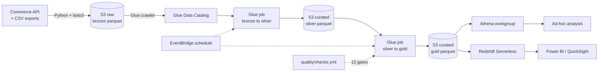

# Architecture

## One-line summary

EventBridge fires a daily trigger, Glue PySpark jobs move data from bronze to
silver to gold inside S3, and analysts query the gold layer from Athena while BI
reads the same data from Redshift Serverless.

## Components

| Component | Resource | Purpose |
|---|---|---|
| Raw zone | `aws_s3_bucket.raw` | Immutable landing area, one prefix per source table, `dt=` partition per load |
| Curated zone | `aws_s3_bucket.curated` | Silver and gold parquet, ZSTD compressed, lifecycle to Standard-IA at 90 days |
| Catalog | `aws_glue_catalog_database` | Schema and partition store; Athena and Redshift Spectrum read from it |
| Crawler | `aws_glue_crawler.bronze` | Registers new bronze partitions hourly |
| Transform jobs | `aws_glue_job.bronze_to_silver`, `silver_to_gold` | PySpark 3.3, G.1X workers, job bookmarks on |
| Trigger | `aws_glue_trigger.daily` | 02:00 IST schedule, sequential (silver before gold) |
| Query | `aws_athena_workgroup.analysts` | Enforced config, 1 GB per-query scan cap |
| Warehouse | `aws_redshiftserverless_workgroup.bi` | 8 RPU base capacity, `DISTKEY(date_key)`, `COMPOUND SORTKEY(date_key, customer_key)` |
| Alarms | `aws_cloudwatch_metric_alarm` | Fires on any failed Glue task |

## Data flow, stage by stage

1. **Extract.** `extract/api_client.py` paginates the commerce API with cursor
   pagination and exponential backoff (5 attempts, capped at 30 s). CSV drops are
   picked up from the landing folder. Nothing is transformed here.
2. **Bronze.** `ingest.land()` writes parquet with every column as `VARCHAR` and
   stamps `_ingest_ts`. Bronze is the audit trail: if silver is ever wrong, bronze
   still has what the source sent.
3. **Silver.** Four models clean one table each. Two date formats are tried in
   order, statuses collapse to four values, duplicates collapse with
   `row_number() over (partition by id order by _ingest_ts desc)`, and rows with
   no join key or no parseable date are dropped rather than guessed.
4. **Gold.** Dimensions get surrogate keys, `dim_date` covers the full observed
   range, and `fct_order_items` nets returns against sales at order-line grain.
5. **Serve.** Athena reads gold parquet in place - no copy, no load step. Redshift
   Serverless takes a `COPY` of the same parquet for BI tools that need a
   warehouse connection.

## Failure handling

| Failure | Detection | Response |
|---|---|---|
| Source extract is late or empty | `silver_orders_not_empty` gate | Run fails, CI and CloudWatch alarm fire, last good gold partition stays in place |
| A new status value appears upstream | `silver_orders_no_blank_customer` and the `unknown` status bucket | Silver keeps the row with status `unknown`; a warn-severity check reports the count |
| Glue job runs out of memory | `numFailedTasks` alarm | Increase `glue_number_of_workers`; the job bookmark means the retry resumes, not restarts |
| Duplicate delivery of the same day | `MERGE` on `order_item_id` in Redshift, overwrite of the day's partition locally | Revenue cannot double-count |
| Schema drift in a source column | Crawler updates the catalog; silver `try_cast` returns null instead of failing | Gate `silver_items_positive_price` catches silent nulls |

## Why these choices

Each significant decision has a short ADR in [decisions/](decisions/). The two
worth reading first are 0002 (partitioning) and 0004 (local DuckDB mode).
